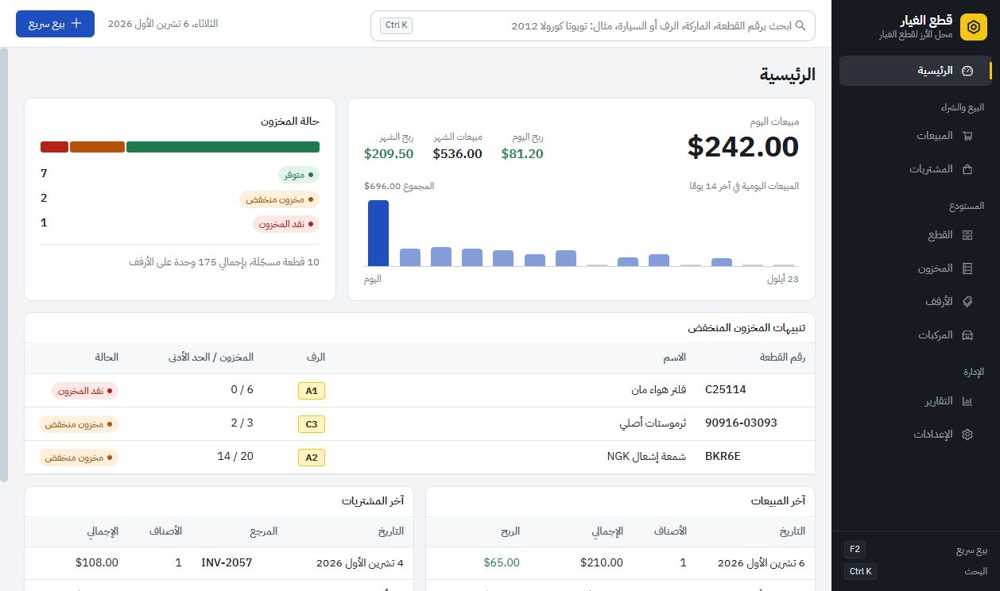
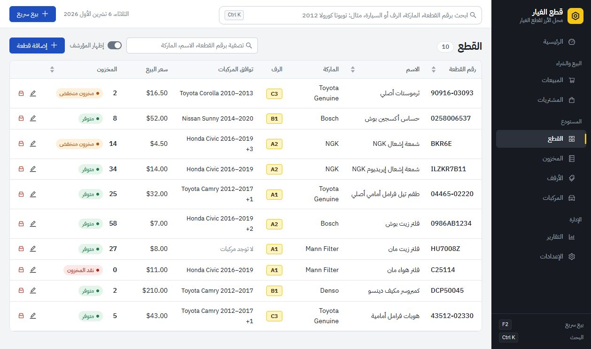
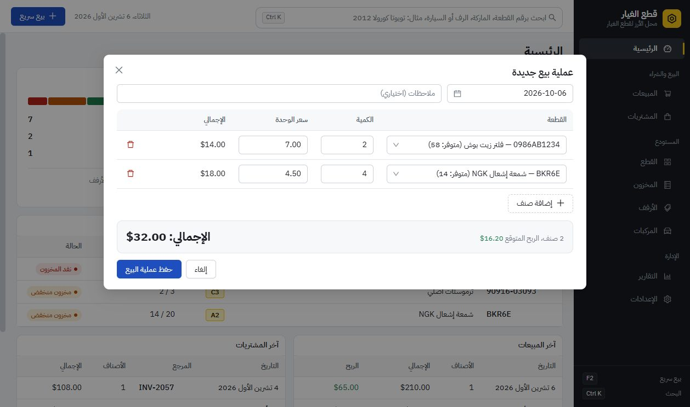
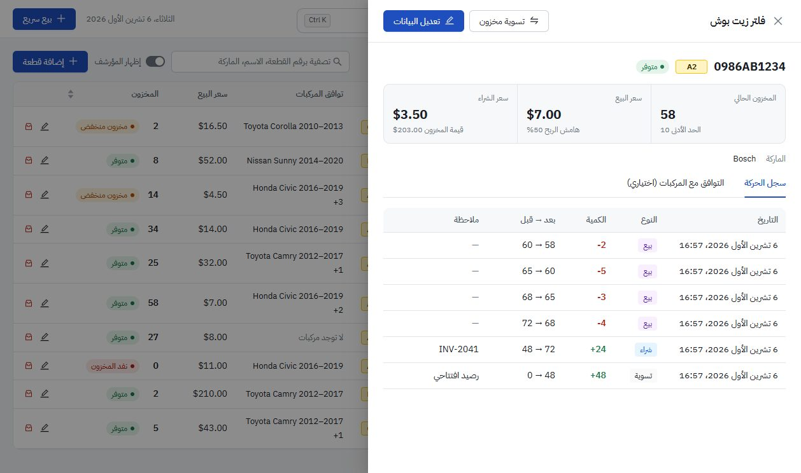
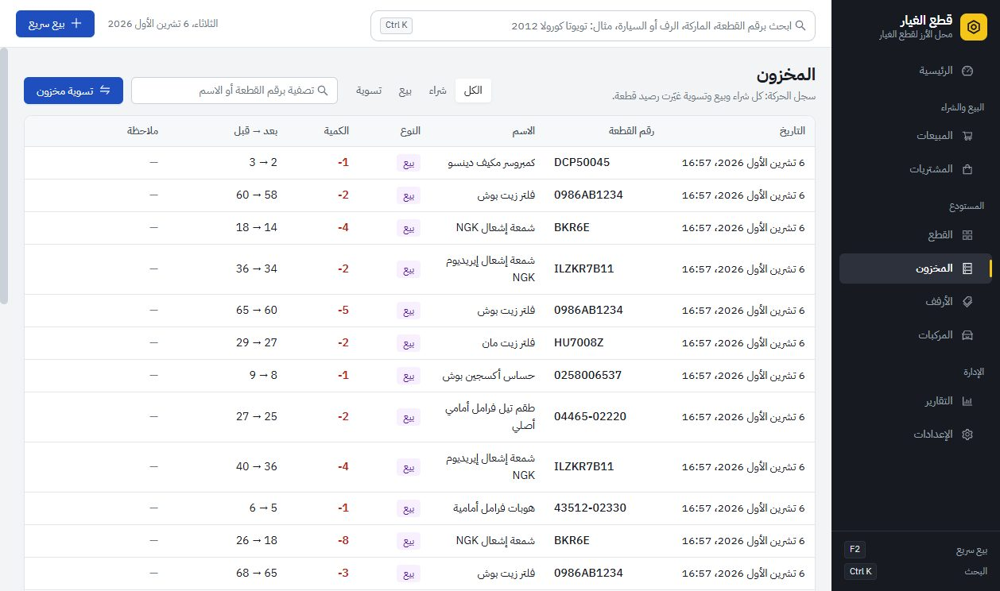
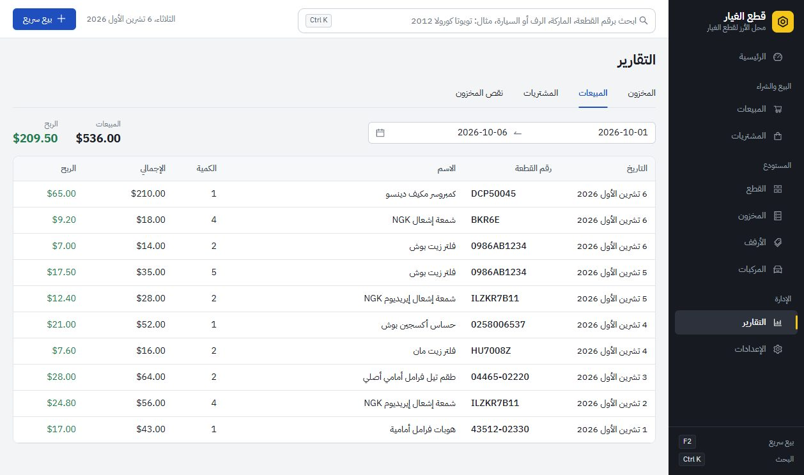

# قطع الغيار · Auto Parts Offline

**A Windows desktop app for an auto-parts shop: inventory, sales, purchasing and reports, in Arabic, with no internet needed.**

## The problem

An auto-parts shop needed to know, at the counter, whether a part is in stock, which shelf it's on, which cars it fits and what was sold today. It had to run on the shop's own computer, work without internet, and be fully in Arabic.

## The solution

A desktop app that runs on the shop's own computer with no connection and no server. Every part, sale and purchase lives in a local database, the whole interface is in Arabic, and any part can be found in seconds by number, name, shelf or car model.

## Key features

- **Parts catalogue** with part numbers, brands, shelf locations, prices and the vehicles each part fits.
- **Fast search** by part number, name, shelf or car (for example "Toyota Corolla 2012"), from anywhere with `Ctrl + K`.
- **Sales and purchases** with multi-line invoices, totals and daily profit.
- **Stock history:** every change is recorded as a sale, purchase or adjustment, so the story of any part is always visible.
- **Low-stock alerts** on the dashboard.
- **Reports** for sales, purchases, inventory and low stock over any date range.
- **Backup and restore**, with an automatic safety copy before every restore.
- **Arabic user guide** delivered with the app.

## Screenshots

| Dashboard | Parts |
| --- | --- |
|  |  |

| New sale | Part history |
| --- | --- |
|  |  |

| Stock movements | Sales report |
| --- | --- |
|  |  |

## Tech stack

| | |
| --- | --- |
| **Languages** | TypeScript, SQL, CSS |
| **Desktop** | Electron |
| **Interface** | React 19, Ant Design 5 |
| **Database** | SQLite (better-sqlite3) |
| **Validation** | Zod |
| **Testing** | Vitest (unit), Playwright (end-to-end) |
| **Packaging** | electron-builder (Windows installer) |

---

> **Source code is private.** All data shown is sample data. For hiring or client review, code access is available on request: DM [@cedarcode.lb](https://instagram.com/cedarcode.lb) or visit [cedarcodesite.com](https://cedarcodesite.com).

© 2026 CedarCode. All rights reserved.
